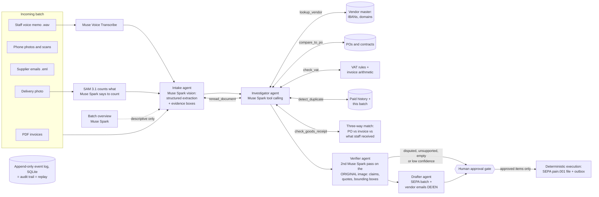

# Ledgerline

**Check supplier invoices against what arrived, before creating a payment file.**

The invoice bills 600 kg of coffee, ten 60 kg sacks. The delivery photo shows nine. Ledgerline links the invoice, purchase order
and receiving evidence, flags the EUR 426 discrepancy, and drafts a supplier email for review.

The demo follows a fictional Berlin coffee roaster. Meta's Muse Spark reads invoices and runs checks against
supplier records; Muse Voice Transcribe reads staff voice memos; SAM counts objects in delivery photos. A second
model pass reviews the proposed decisions and cites source regions. A person reviews the resulting payment
instructions, email drafts and exceptions. Ledgerline exports files; it does not send payments or emails.

> Built during the Meta Global AI Developer Hackathon (Oct 26 – Nov 4, 2026): the code was written Nov 2–4,
> inside the event window, and the git history starts with the first working version on Nov 2. Startup track ·
> theme *Build for Your World*. Built with Muse Spark Open.

**Try it in your browser, no install:** https://founder-sk-hub.github.io/ledgerline/ (replays of recorded real
runs; you are the approver) · **Demo video (3 min):** https://youtu.be/Ha7zp2gprn0

<!-- RESULTS:START -->
### Results on the synthetic benchmark (recorded live runs, replayable in the app)

| Engine | Docs | Anomalous docs stopped | Flag recall | Flag precision | Decision accuracy | EUR at risk caught | Agent time | Model cost | Recorded |
|---|---|---|---|---|---|---|---|---|---|
| Muse Glimmer · on this machine (Ollama) (`muse-glimmer:30b-mlx`) | 6 | 4/4 | 80% | 57% | 83% | EUR 4,088.90 | 45.0 min | $0.00 | 2026-11-02 |
| Muse Spark · Meta Model API (`muse-spark-1.3`) | 32 | 12/12 | 100% | 94% | 97% | EUR 8,339.21 | 2.7 min | $1.10 | 2026-11-02 |

Scored against `data/samples/ground_truth.json`, which the agent never sees. Local runs cost $0 in API fees.
<!-- RESULTS:END -->

How to read the two rows: on Meta Model API every planted problem was stopped. The one extra flag is a real
warning sign the answer key doesn't list: the fake bank-change email pushes for payment by a deadline and says the
sender can't be reached by phone. The one "wrong" decision is a clean invoice sent to a human: on a phone photo
the IBAN check digits read as 46 instead of 26. The checksum marks that as a misreading, but the second pass would
not sign off on it and asked a human instead of guessing. On the laptop, Muse
Glimmer stopped all four problem documents in its six-document subset, but the coffee invoice only because its
extraction failed and it went to a human; it also raised more false flags. Private mode trades accuracy and speed
for keeping every document on the machine.

---

## Try it in 2 minutes (no API key)

Replay mode streams **recorded real runs**: every model call in the timeline is from a live run, with its recorded
latency, token usage, cost and response id. You act as the approver. (In the Muse Glimmer recording a call's latency
includes waiting for a free slot while six calls run in parallel; the Muse Spark recording and the current code
time the model call alone.)

```bash
git clone https://github.com/founder-sk-hub/ledgerline && cd ledgerline
python3 -m venv .venv && .venv/bin/pip install -r backend/requirements.txt
make demo            # -> http://localhost:8000
```

The UI is prebuilt in `frontend/dist`, so Node is only needed if you change it (`make frontend`).
Python 3.11+.

## Run it live with your own key

```bash
cp .env.example .env     # then set MODEL_API_KEY (and BASETEN_API_KEY for private mode)
make live                # -> http://localhost:8000, choose "Live"
# or headless, printing every step:
.venv/bin/python backend/scripts/record.py --provider meta           # full 32-document batch
.venv/bin/python backend/scripts/record.py --provider meta --limit 3 # quick smoke test
```

Live uploads still use the fictional company's reference records; customer onboarding and reference-data import
are not implemented. A local budget guard (`LEDGERLINE_BUDGET_USD`, default 40)
refuses new model calls once Ledgerline's own recorded spend reaches the limit.

---

## How it works



**The model decides, code computes.** Muse Spark chooses which checks a document needs, interprets the findings
and writes the rationale and emails. Deterministic tools do the lookups and the arithmetic and attach a computed
EUR-at-risk to every finding. Figures in flags, totals and the SEPA file come from code; free-text summaries written
by the model can contain mistakes.

| Stage | What happens | Model |
|---|---|---|
| Plan | Summarizes the batch and suggests a watchlist. This is displayed but does not control routing | Muse Spark |
| Intake | Reads up to six page images per PDF, or an email: type, vendor, IBAN, lines, VAT and totals. Returns quotes and bounding boxes. Voice memos are transcribed first; for delivery photos Muse Spark proposes an object class and SAM returns detections | Muse Spark, Muse Voice Transcribe, SAM 3.1 |
| Investigate | Tool loop per document: `lookup_vendor`, `compare_to_po`, `check_vat`, `detect_duplicate`, `check_goods_receipt`, `reread_document`, then `submit_decision` (approve / hold / reject / escalate / file) | Muse Spark (parallel tool calls) |
| Verify | Second pass using the same model, source document, extracted fields and proposed rationale. Disputed, unsupported, empty or low-confidence results escalate. This is model review, not independent ground truth | Muse Spark (vision, grounding) |
| Draft | Builds a proposed payment batch from model-approved documents (selected credit notes netted, vendor-master IBANs), writes supplier email drafts, requests approval | Muse Spark (tool calling) |
| Approve | A human approves or rejects payments and emails, and records exception reviews. Exceptions remain outside the export | – |
| Execute | Deterministic code writes an ISO 20022 `pain.001.001.09` SEPA file and an email outbox. Nothing is transmitted | – |

Every step (model call, tool call and result, decision, approval) is an append-only event. The UI, the audit trail,
the metrics and the replays are all folds over that one log.

### What it catches (planted in the sample batch)

| Anomaly | How it's caught |
|---|---|
| Same invoice re-sent as a scan with a KOPIE stamp | `detect_duplicate`: same vendor + number as an earlier document |
| "Reminder" re-issuing an invoice that was already paid (`CT-2026-09-R`) | `detect_duplicate` against paid history: re-issued number |
| Unit price +12.0% over the PO; labour rate +11.8% over the contract | `compare_to_po` against PO lines and contract terms |
| Milk charged at 19% instead of 7%; Dutch 21% VAT on an intra-EU B2B supply | `check_vat`: DE reduced rate / reverse-charge rules |
| Line total 1,880 but net 1,980 | `check_vat` arithmetic |
| 12,000 cups billed when only 10,000 remain on the PO | `compare_to_po` with PO consumption (duplicates counted once) |
| Email from `kaffeimport-hansa.com` asking to pay a new Lithuanian IBAN | `lookup_vendor`: IBAN mismatch + lookalike sender domain → reject, alert the known contact |
| Unknown vendor, no PO, above the EUR 500 policy | `lookup_vendor` + PO policy → escalate to a human |
| Contract renewal raising a fee 249 → 279 EUR/month | `compare_to_po` on contract terms → info flag |
| Dairy invoice bills 400 L; the branch manager's voice memo says only 28 of 40 cans (280 L) came | Muse Voice Transcribe → `check_goods_receipt` → hold, EUR 139.96 |
| Coffee invoice bills 600 kg; the receiving photo shows 9 sacks of 60 kg | SAM 3.1 counts 9 sacks → `check_goods_receipt` → hold, EUR 426.00 |

It also has to *not* flag the 12 clean invoices, two card-paid receipts (one with mixed 7%/19% VAT), a credit
note, a delivery note and a newsletter.

## Meta models used, and where

| Model | Served by | Used for |
|---|---|---|
| **Muse Spark 1.3** (`muse-spark-1.3`) | Meta Model API (`api.meta.ai/v1`) | All five agents in standard mode: planner, intake (vision + grounding), investigator (tool calling), verifier (vision + grounding), drafter |
| **Muse Voice Transcribe** (`muse-voice-transcribe-1.0`) | Meta Model API | Transcribes staff voice memos (German/English code-switching, vendor names as vocabulary bias) |
| **SAM 3.1** (`sam-3.1`) | Meta Model API | Segments and counts delivered goods in receiving photos; boxes are shown in the audit trail |
| **Muse Glimmer** (`muse-glimmer:30b-mlx`, open weights) | **Your own laptop** via Ollama | Private mode: the same agents on-device, without voice memos or SAM. No document leaves the machine |
| **Muse Spark Open** (`meta-models/muse-spark-open-1026`, open weights) | Baseten, or any OpenAI-compatible server you host | Private mode on a server you control. Configured, not benchmarked yet |
| Muse Image (`muse-image-1.0`) | Meta Model API | Development only: generated the synthetic delivery photo in the sample batch |

The default runtime uses only Meta models. Model IDs and endpoints are configurable in `.env`; keep all runtime
models Meta models for this submission. The OpenAI SDK is a client library here, not an OpenAI model call.

**Private modes:** *On this laptop* runs Muse Glimmer locally through Ollama: invoices never leave
the machine. Voice memos and SAM counting need Meta Model API, so private modes skip them (the voice memo is
escalated to a human, photos are counted by the open model itself). *Open-weights server* sends documents to the
server you configure (Baseten in the demo). On Meta Model API, requests paid with free promotional credits may be
used for product improvement; the demo data is synthetic for that reason.

To run the local engine: install [Ollama](https://ollama.com) ≥ 0.32.7, then `ollama pull muse-glimmer:30b-mlx`
(19 GB; fits a 32 GB+ Apple-silicon Mac) and choose *Private · on this laptop* in the UI, or
`record.py --provider local`. The trade-off is speed: the six-document local run took 45 minutes on an M3 Pro
(36 GB), while the 32-document Meta Model API run took under three minutes. That suits an overnight batch. The recorded private-mode replay covers six documents, compared with 32
in the standard run; these are not equivalent benchmarks.
Ollama's MLX engine has no constrained decoding, so the local engine gets the JSON
schema in its instructions and its output is parsed strictly, with one retry.

## Non-AI services and libraries

- **Ollama**: local runtime for Muse Glimmer (private mode on this laptop).
- **Baseten**: inference hosting for Muse Spark Open (private mode on a server).
- No search APIs or other external services. VAT ID checks are format-only (no VIES call).
- Backend: Python, FastAPI, Uvicorn, `openai` SDK (as an OpenAI-compatible client for Meta / Baseten endpoints),
  pypdfium2 (PDF rendering), Pillow, NumPy, sse-starlette, SQLite.
- Frontend: React, Vite, Tailwind CSS, lucide-react icons, Inter / JetBrains Mono (Google Fonts).
- Dev only: fpdf2 (sample generation), ElevenLabs text-to-speech (the synthetic voice memo), pytest. Demo video
  only: Playwright, ffmpeg and ElevenLabs text-to-speech (see Disclosures).

## Synthetic data and benchmark

Everything in `data/samples` is **synthetic**: Spree Roastery GmbH, a fictional Berlin coffee roaster, with eight
invented vendors, five POs, four contracts, a paid-invoice history, and a 32-document October batch in German and
English. The batch includes PDFs, phone photos, a stamped scan, thermal receipts, emails, a staff voice memo
(a synthetic German voice from ElevenLabs text-to-speech, `make_voice_memo.py`) and a delivery photo (generated with
Meta's Muse Image).
IBANs are checksum-valid but random. `backend/scripts/generate_samples.py` regenerates the batch on macOS (it uses system
fonts and reuses the committed voice memo and Muse Image photo).

`data/samples/ground_truth.json` lists the planted anomalies. It is **never shown to the agent**. It is only used
afterwards to score a run (Metrics tab, and `record.py` output): flag precision and recall, decision accuracy, and
how many anomalous documents were stopped.

`make test` runs 74 offline tests. They check that, given a perfect reading of each document, the deterministic
tools surface exactly the planted anomalies and EUR at risk, and that the full pipeline through the API, approval
gate, SEPA export and record/replay works.

## Export controls and limits

- **Human approval gate.** The agent can only *draft*. Execution needs every item decided by a person, and then
  runs as deterministic code that uses only what was approved.
- **Bank details come from the vendor master**, never from a document. A changed IBAN is a fraud signal, not an update.
- **Model review** checks proposed decisions against the source image. The same model can repeat an earlier error.
- **Exceptions stay excluded.** Marking an exception reviewed does not release a payment or trust an extracted IBAN.
- **Emails go only to known vendor contacts** from the master data, never to the sender of a suspicious message.
- **Nothing is transmitted.** Ledgerline writes a SEPA file and an outbox. Uploading and sending stay human actions.
- **Budget guard** on model spend.

The benchmark is one synthetic scenario, not evidence of accuracy on unseen customer invoices. Time savings are
estimates based on eight minutes per document and assumed review time, not measured user outcomes. PDF intake
currently reads only the first six pages. Receiving-evidence matching needs stronger product and unit checks on
multi-line invoices. The investigator chooses its checks and can dismiss findings; mandatory policy enforcement
is not yet complete. The app is a prototype for local use, not a shared production accounting service.

## Browser demo and demo video

`backend/scripts/export_static.py` builds `site/`, a static version of the app (`VITE_STATIC=1`) in which the
recorded replays, the approval gate and SEPA generation run entirely in the browser (`frontend/src/static/`, a port
of the Python fold). It is what GitHub Pages serves. The demo video is produced by `backend/scripts/demo_video.py`,
which drives the real app with Playwright, and `demo_voice.py`, which generates the narration with ElevenLabs. Both
are video production only and not part of the product. A `Dockerfile` serves the replay demo (no keys) on port
7860 for self-hosting.

## Repository layout

```
backend/ledgerline/   agents.py (orchestrator + prompts) · tools.py (deterministic checks) · providers.py
                      documents.py (PDF/photo/email intake) · state.py (event fold + metrics + eval)
                      execution.py (approval gate, SEPA) · replay.py · api.py · db.py · config.py
backend/scripts/      generate_samples.py · record.py · readme_results.py · export_static.py (browser demo)
                      demo_voice.py · demo_video.py (video production only)
backend/tests/        tool tests against planted anomalies + end-to-end pipeline test
frontend/src/         Start · Live run · Approval queue · Audit trail · Metrics · static/ (in-browser replay engine)
data/samples/         synthetic company, batch, ground truth
data/replays/         recorded real runs (replay mode)
```

## Disclosures

- Built from scratch during the hackathon window (Oct 26 – Nov 4, 2026); no pre-existing code. The first commit
  (Nov 2) contains the first working version written that day.
- The Muse Spark replay was recorded with the current code. The Muse Glimmer replay was recorded before later
  wording, verifier and export changes; re-scoring it under the current rules gives the same outcomes.
- Demo video narration: ElevenLabs text-to-speech (the "Brian" narrator voice). The sample batch's staff voice
  memo is also ElevenLabs text-to-speech. Neither is part of the product's runtime.
- Development used Claude and Codex. The event's [coding-assistant clarification](https://discord.com/channels/1557169028080869426/1566625461319106610/1566625482143699178)
  permits those development tools; runtime model calls must use Meta models.
- All demo data is synthetic and labelled as such. Ledgerline is a demo, not tax or legal advice. VAT rules cover the
  German and intra-EU cases in the sample batch.

## License

MIT, see [LICENSE](LICENSE). Muse Spark Open weights are distributed by Meta under the Muse Model License.

**Built with Muse Spark Open.**
