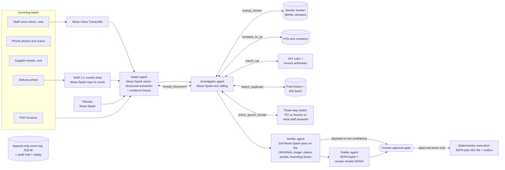

# Ledgerline

**A verifiable back-office agent for small businesses, built on Meta's Muse models.**

Drop in a messy month of invoices, receipts, contracts and supplier emails (PDFs, phone photos, scans, `.eml`),
plus what your staff record at the back door: a **voice memo** ("only 28 cans of milk came") or a **photo of the
delivery**. Ledgerline reads and hears every document, checks it against your vendor master, purchase orders,
contracts, VAT rules, payment history and what actually arrived, and catches the expensive mistakes: duplicates,
price drift, wrong VAT, over-billing, short deliveries, math errors and payment-diversion fraud. A second Muse Spark pass verifies every decision against the original document and
cites where it found the evidence. Then it drafts the SEPA payment batch and the vendor emails, and **stops for a
human**. Nothing is paid or sent without approval, and every step is in a replayable audit trail that answers
"why did it do that?".

> Built entirely during the Meta Global AI Developer Hackathon (Oct 26 – Nov 4, 2026). Startup track ·
> theme *Build for Your World*.

<!-- RESULTS:START -->
### Results on the synthetic benchmark (recorded live runs, replayable in the app)

| Engine | Docs | Anomalous docs stopped | Flag recall | Flag precision | Decision accuracy | EUR at risk caught | Agent time | Model cost | Recorded |
|---|---|---|---|---|---|---|---|---|---|
| Muse Spark · Meta Model API (`muse-spark-1.3`) | 32 | 12/12 | 100% | 100% | 97% | EUR 8,339.21 | 5.8 min | $1.25 | 2026-11-02 |

Scored against `data/samples/ground_truth.json`, which the agent never sees. Local runs cost $0 in API fees.
<!-- RESULTS:END -->

---

## Try it in 2 minutes (no API key)

Replay mode streams **recorded real runs**: every Muse Spark call in the timeline is from a live run, with its real
latency, token usage, cost and response id. You act as the approver.

```bash
git clone https://github.com/sindakhenine/ledgerline && cd ledgerline
python3 -m venv .venv && .venv/bin/pip install -r backend/requirements.txt
make demo            # -> http://localhost:8000
```

The UI is prebuilt in `frontend/dist`, so Node is only needed if you change it (`make frontend`).
Python 3.11+.

## Run it live with your own key

```bash
cp .env.example .env     # then set MODEL_API_KEY (and BASETEN_API_KEY for private mode)
make live                # -> http://localhost:8000, choose "Live"
# or headless, printing every step:
.venv/bin/python backend/scripts/record.py --provider meta           # full 30-document batch
.venv/bin/python backend/scripts/record.py --provider meta --limit 3 # quick smoke test
```

In live mode you can also upload your own documents. A local budget guard (`LEDGERLINE_BUDGET_USD`, default 40)
refuses new model calls once Ledgerline's own recorded spend reaches the limit.

---

## How it works



**The model decides, code computes.** Muse Spark chooses which checks a document needs, interprets the findings
and writes the rationale and emails. Deterministic tools do the lookups and the arithmetic and attach a computed
EUR-at-risk to every finding, so the money figures never depend on model arithmetic.

| Stage | What happens | Model |
|---|---|---|
| Plan | Reads the batch manifest, writes a plan and a watchlist (possible re-sends, bank-change subjects, non-invoices) | Muse Spark |
| Intake | Reads each page image or email: type, vendor, IBAN, lines, VAT, totals, anything odd (stamps, handwriting, pressure). Returns quotes and 0–1000 bounding boxes as evidence. Voice memos are transcribed first (vocabulary-biased with your vendor names); for delivery photos Muse Spark decides *what* to count ("jute coffee sack") and SAM 3.1 segments and counts every instance | Muse Spark (vision, structured output, grounding), Muse Voice Transcribe, SAM 3.1 |
| Investigate | Tool loop per document: `lookup_vendor`, `compare_to_po`, `check_vat`, `detect_duplicate`, `check_goods_receipt`, `reread_document`, then `submit_decision` (approve / hold / reject / escalate / file) | Muse Spark (parallel tool calls) |
| Verify | Independent second pass: checks each claim against the original document, with a quote, page and bounding box per claim. Disputed or < 0.75 confidence → escalated to a human | Muse Spark (vision, grounding) |
| Draft | Builds the payment batch from verified approvals (credit notes netted, **always the vendor-master IBAN**), writes vendor emails in the vendor's language, requests approval | Muse Spark (tool calling) |
| Approve | A human approves or rejects every payment, email and escalation | – |
| Execute | Deterministic code writes an ISO 20022 `pain.001.001.09` SEPA file and an email outbox. Nothing is transmitted | – |

Every step (model call, tool call and result, decision, approval) is an append-only event. The UI, the audit trail,
the metrics and the replays are all folds over that one log.

### What it catches (planted in the sample batch)

| Anomaly | How it's caught |
|---|---|
| Same invoice re-sent as a scan with a KOPIE stamp | `detect_duplicate`: same vendor + number as an earlier document |
| "Reminder" re-issuing an invoice that was already paid (`CT-2026-09-R`) | `detect_duplicate` against paid history: re-issued number |
| Unit price +12.0% over the PO; labour rate +11.8% over the contract | `compare_to_po` against PO lines and contract terms |
| Milk charged at 19% instead of 7%; Dutch 21% VAT on an intra-EU B2B supply | `check_vat`: DE reduced rate / reverse-charge rules |
| Line total 1,880 but net 1,980 | `check_vat` arithmetic |
| 12,000 cups billed when only 10,000 remain on the PO | `compare_to_po` with PO consumption (duplicates counted once) |
| Email from `kaffeimport-hansa.com` asking to pay a new Lithuanian IBAN | `lookup_vendor`: IBAN mismatch + lookalike sender domain → reject, alert the known contact |
| Unknown vendor, no PO, above the EUR 500 policy | `lookup_vendor` + PO policy → escalate to a human |
| Contract renewal raising a fee 249 → 279 EUR/month | `compare_to_po` on contract terms → info flag |
| Dairy invoice bills 400 L; the branch manager's voice memo says only 28 of 40 cans (280 L) came | Muse Voice Transcribe → `check_goods_receipt` → hold, EUR 139.96 |
| Coffee invoice bills 600 kg; the receiving photo shows 9 sacks of 60 kg | SAM 3.1 counts 9 sacks → `check_goods_receipt` → hold, EUR 426.00 |

It also has to *not* flag the 12 clean invoices, two card-paid receipts (one with mixed 7%/19% VAT), a credit
note, a delivery note and a newsletter.

## Meta models used, and where

| Model | Served by | Used for |
|---|---|---|
| **Muse Spark 1.3** (`muse-spark-1.3`) | Meta Model API (`api.meta.ai/v1`) | All five agents in standard mode: planner, intake (vision + grounding), investigator (tool calling), verifier (vision + grounding), drafter |
| **Muse Voice Transcribe** (`muse-voice-transcribe-1.0`) | Meta Model API | Transcribes staff voice memos (German/English code-switching, vendor names as vocabulary bias) |
| **SAM 3.1** (`sam-3.1`) | Meta Model API | Segments and counts delivered goods in receiving photos; boxes are shown in the audit trail |
| **Muse Glimmer** (`muse-glimmer:30b-mlx`, open weights) | **Your own laptop** via Ollama | Private mode: the same five agents fully on-device. No document leaves the machine |
| **Muse Spark Open** (`meta-models/muse-spark-open-1026`, open weights) | Baseten, or any OpenAI-compatible server you host | Private mode on a server you control |
| Muse Image (`muse-image-1.0`) | Meta Model API | Development only: generated the synthetic delivery photo in the sample batch |

No other AI model is called at runtime. Model ids and endpoints are configurable in `.env`.

**Private modes, honestly stated:** *On this laptop* runs Muse Glimmer locally through Ollama: invoices never leave
the machine. Voice memos and SAM counting need Meta Model API, so private modes skip them (the voice memo is
escalated to a human, photos are counted by the open model itself). *Open-weights server* sends documents to the
server you configure (Baseten in the demo). On Meta Model API, requests paid with free promotional credits may be
used for product improvement; the demo data is synthetic for that reason.

To run the local engine: install [Ollama](https://ollama.com) ≥ 0.32.7, then `ollama pull muse-glimmer:30b-mlx`
(19 GB; fits a 32 GB+ Apple-silicon Mac) and choose *Private · on this laptop* in the UI, or
`record.py --provider local`.

## Non-AI services and libraries

- **Ollama**: local runtime for Muse Glimmer (private mode on this laptop).
- **Baseten**: inference hosting for Muse Spark Open (private mode on a server).
- No search APIs or other external services. VAT ID checks are format-only (no VIES call).
- Backend: Python, FastAPI, Uvicorn, `openai` SDK (as an OpenAI-compatible client for Meta / Baseten endpoints),
  pypdfium2 (PDF rendering), Pillow, NumPy, sse-starlette, SQLite.
- Frontend: React, Vite, Tailwind CSS, lucide-react icons, Inter / JetBrains Mono (Google Fonts).
- Dev only: fpdf2 (sample generation), pytest.

## Synthetic data and benchmark

Everything in `data/samples` is **synthetic**: Spree Roastery GmbH, a fictional Berlin coffee roaster, with eight
invented vendors, five POs, four contracts, a paid-invoice history, and a 32-document October batch in German and
English. The batch includes PDFs, phone photos, a stamped scan, thermal receipts, emails, a staff voice memo
(synthetic voice from macOS text-to-speech) and a delivery photo (generated with Meta's Muse Image). IBANs are
checksum-valid but random. `backend/scripts/generate_samples.py` regenerates everything.

`data/samples/ground_truth.json` lists the planted anomalies. It is **never shown to the agent**. It is only used
afterwards to score a run (Metrics tab, and `record.py` output): flag precision and recall, decision accuracy, and
how many anomalous documents were stopped.

`make test` runs 70 tests. They show that, given a perfect reading of each document, the deterministic tools
surface exactly the planted anomalies and the correct EUR at risk, and that the full pipeline through the API,
approval gate, SEPA export and record/replay works.

## Safety by design

- **Human approval gate.** The agent can only *draft*. Execution needs every item decided by a person, and then
  runs as deterministic code that uses only what was approved.
- **Bank details come from the vendor master**, never from a document. A changed IBAN is a fraud signal, not an update.
- **Independent verification** of every decision against the source image. Disagreement or low confidence escalates.
- **Emails go only to known vendor contacts** from the master data, never to the sender of a suspicious message.
- **Nothing is transmitted.** Ledgerline writes a SEPA file and an outbox. Uploading and sending stay human actions.
- **Budget guard** on model spend.

## Repository layout

```
backend/ledgerline/   agents.py (orchestrator + prompts) · tools.py (deterministic checks) · providers.py
                      documents.py (PDF/photo/email intake) · state.py (event fold + metrics + eval)
                      execution.py (approval gate, SEPA) · replay.py · api.py · db.py · config.py
backend/scripts/      generate_samples.py · record.py
backend/tests/        tool tests against planted anomalies + end-to-end pipeline test
frontend/src/         Start · Live run · Approval queue · Audit trail · Metrics
data/samples/         synthetic company, batch, ground truth
data/replays/         recorded real runs (replay mode)
```

## Disclosures

- Built from scratch during the hackathon window (Oct 26 – Nov 4, 2026); no pre-existing code.
- All runtime AI is Meta models (above). Development was assisted by an AI coding assistant; no non-Meta model is
  part of the product or called at runtime.
- All demo data is synthetic and labelled as such. Ledgerline is a demo, not tax or legal advice. VAT rules cover the
  German and intra-EU cases in the sample batch.

## License

MIT, see [LICENSE](LICENSE). Muse Spark Open weights are distributed by Meta under the Muse Model License.
